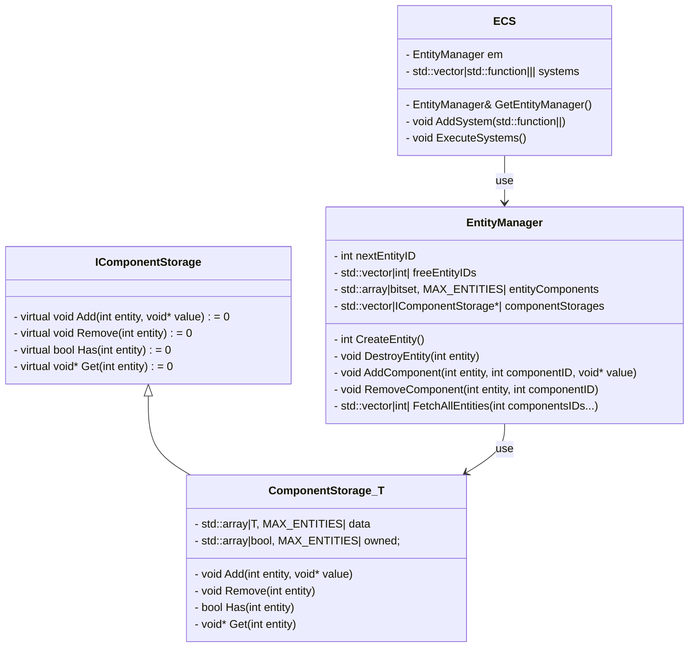

# Minimal ECS



## IComponentStorage

```cpp

class IComponentStorage
{
    virtual ~IComponentStorage() = default;
    
    virtual void Add(int entity, void* value) = 0;
    virtual void Remove(int entity) = 0;
    virtual bool Has(int entity) = 0;
    virtual void* Get(int entity) = 0;

    // void* is sued for generic programming
    // The idea is to have a std::vector<IComponentStorage*> that is able to contain
    // ComponentStorage<Test1>, ComponentStorage<Test2>...
    // inside the same std::vector
    // so we need to abstract the component type => void*
}
```

## ComponentStorage<T>

```cpp

template <typename T>
class ComponentStorage
{
    std::array<T, MAX_ENTITIES>     data;
    std::array<bool, MAX_ENTITIES>  owned;
    // Index of the arrays are directly the Entity, which is only an int


    void Add(int entity, void* value)
    {
        // Add ownership of the component to the entity
        // And setup initial value
    }
    void Remove(int entity)
    {
        // Remove the ownership of the component to the entity
    }
    bool Has(int entity)
    {
        // Send if the component is owned by the entity
    }
    void* Get(int entity)
    {
        // Send the address of the specified component
    }
}
```
## EntityManager

```cpp
class EntityManager
{
    int                                 nextEntityID;
    std::vector<int>                    freeEntityIDs;
    std::array<bitset, MAX_ENTITIES>    entityComponents;
    std::vector<IComponentStorage*>     componentStorages;

    // Le concept du bitset est rudimentaire ici
    // Il faut un MAX_COMPONENTS qui correspond au max de bit dans votre type (uint64 ?)
    // L'index dans componentStorage (aka le componentID), c'est le numéros du bit pour le component dans le bitset également

    int CreateEntity()
    {
        // Si pas de freeEntityID alors on incrémente le compteur
    }
    void DestroyEntity(int entity)
    {
        // On ajoute l'index à freeEntityIDs et on supprime les components
    }
    void AddComponent(int entity, int componentID, void* value)
    {
        // Appel le Add du bon ComponentStorage
        // Et modifie le bitset lié à l'entité pour y ajouter le component
    }
    void RemoveComponent(int entity, int componentID)
    {
        // Appel le Remove du bon ComponentStorage
        // Et modifie le bitset lié à l'entité pour y retirer le component
    }
    std::vector<int> FetchAllEntities(int componentsIDs...)
    {
        // Créé le bitset de la recherche avec la liste des componentIDs
        // Créé le vector des Entity(int) qui respectent le bitset de la recherche
        // C'est clairement l'endroit ou les performances s'effondrent le plus, un iterator serait déjà moins horrible
    }
}
```
## ECS

```cpp
using system = std::function<void(EntityManager&)>;

class ECS {
    EntityManager em;
    std::vector<system> systems;

    EntityManager& GetEntityManager() { ... }
    void AddSystem(system)
    {
        // Bon vieux push back
    }
    void ExecuteSystems()
    {
        // Loop sur systems pour les call avec em
    }
}
```

## What's next ?

Simply create one or several sytems for your graphic pipeline/module.
At least one entity for the cow with the needed components and your drawMeshes inside a system.