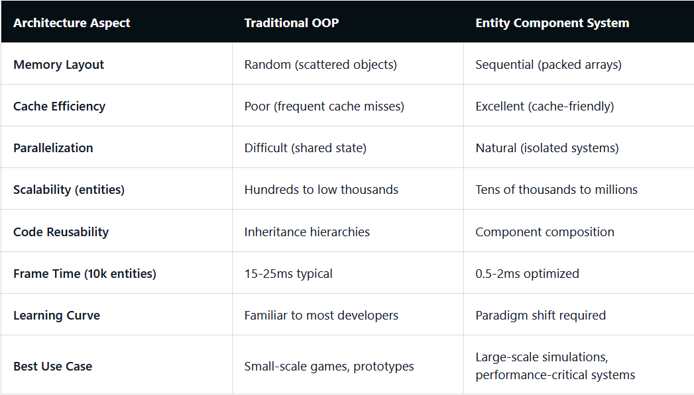
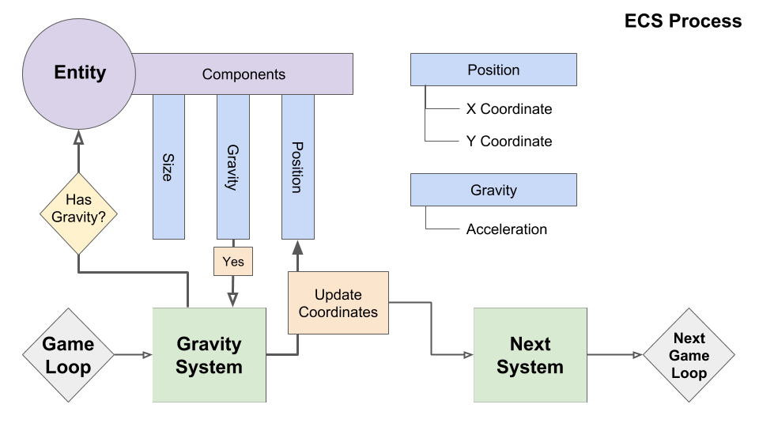

# Entity Component System

## The OOP Problem

Classic game object hierarchies look like: `Entity → Actor → Pawn → Character → FPSCharacter`. Problems at scale:

- Diamond inheritance and brittle hierarchies break when you want a "ghost NPC" (solid? visible? AI? sound?).
- Hell inheritance for new "specializations" makes big software unmaintanble on the long run (poor scalability).
- Cache misses: Iterating 10,000 entities to run a physics update means following pointers to scattered RAM locations. Modern CPUs stall waiting for cache fills.
- Feature coupling: Adding a new feature requires modifying base classes or adding virtual functions that all subclasses pay for.

## For performance nerds

### The Fundamental Performance Problem with OOP

Object-oriented architectures suffer from inherent memory access patterns that clash with modern CPU design. When you call enemy.Update() on 10,000 objects, the CPU must chase pointers scattered randomly across memory, loading each object's entire data structure—including fields you don't need—into precious L1 cache. Modern CPUs prefetch sequential memory brilliantly but perform terribly with random access patterns, causing cache misses that stall execution for 200+ cycles while waiting for RAM.

Virtual function calls exacerbate this problem. Each enemy.Update() requires a vtable lookup through another pointer indirection, preventing compiler optimizations and CPU branch prediction. With inheritance hierarchies, you compound cache misses—the CPU loads the base class, derived class, and vtable from different memory regions. For 10,000 entities updated 60 times per second, these microseconds accumulate into frame-killing milliseconds.

### How ECS Solves These Performance Problems

Entity Component System architecture inverts the OOP model by storing components of the same type contiguously in memory. Instead of 10,000 Enemy objects each containing position, velocity, health, and AI state scattered across RAM, ECS maintains separate arrays: 10,000 positions packed sequentially, 10,000 velocities in another array, and so forth. This seemingly simple reorganization delivers transformative performance because the CPU can now prefetch entire cache lines of positions, process them with SIMD instructions, and move to velocities without ever encountering a cache miss.

The performance gains extend beyond memory layout. ECS systems process components in tight loops without virtual function overhead—the compiler can inline, vectorize, and optimize aggressively. Systems operate independently on different component sets, enabling trivial parallelization across CPU cores. Unity DOTS leverages this through the Burst compiler and Job System, automatically parallelizing ECS workloads across all available cores while maintaining memory safety. The result? Games processing 100,000+ entities at 60 FPS on modest hardware.

## ECS Architecture

To answer all the problems of *scalability*, *testability* and *performances* saw before, ECS is structured this way :

- `Entity`: An entity is a general-purpose object or item within the application. It is typically an empty container that represents a unique entity identifier. It's used to have access to "associated" components.

- `Component`: Components are data containers that hold specific attributes or properties of an entity. They represent different aspects of an entity’s behavior or characteristics, such as position, velocity, rendering details, AI behavior, etc. Components are typically simple data structures without behavior or logic.

- `System`: Systems are responsible for processing entities that have specific sets of components. Each system encapsulates a specific functionality or behavior, such as rendering, physics simulation, AI, input handling, or collision detection. Systems operate on the data contained within the components and can access and modify their properties.

## Implementation sample

- There is a CppCon conference about an implementation from Vittorio Romeo :
[Youtube link](https://www.youtube.com/watch?v=NTWSeQtHZ9M)

- You can find the repository he worked on (more updated than the video) [here](https://github.com/vittorioromeo/ecst)
